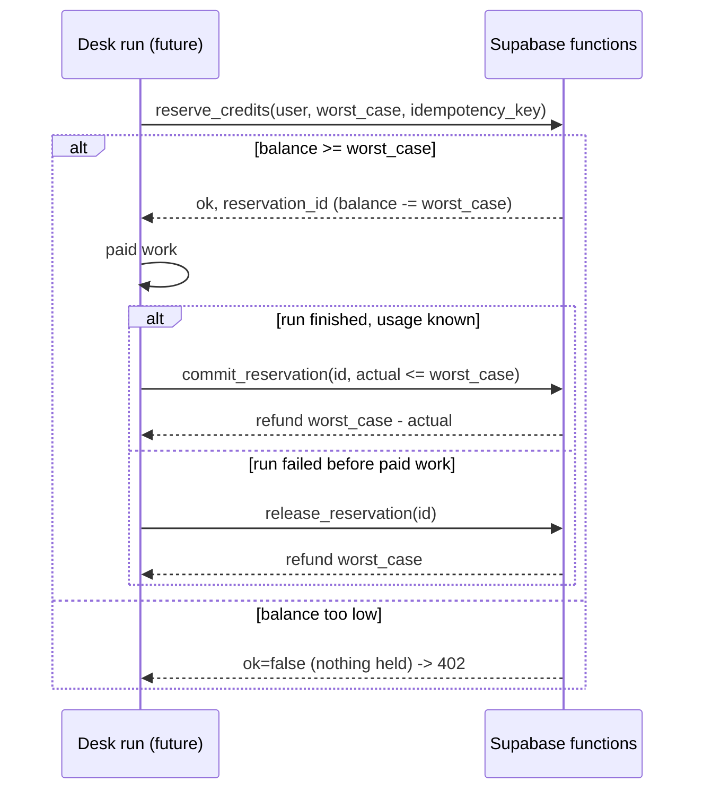
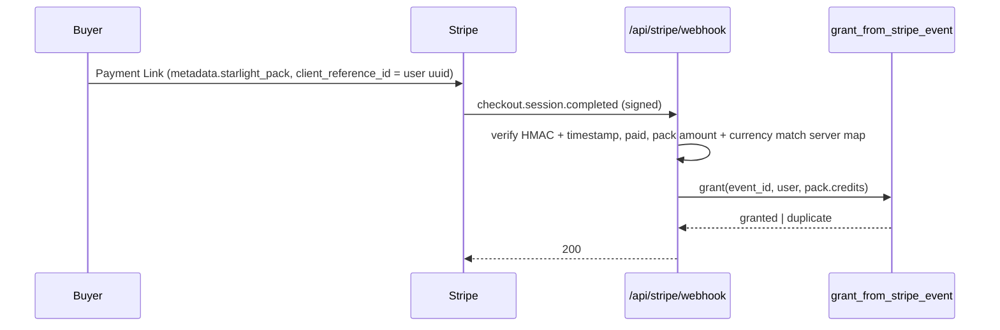

# Credits ledger — architecture

Status: **proposal, disabled by default.** Nothing in this design moves money, and nothing is switched on by merging it. Turning it on requires Frank's approval (see [Enablement checklist](#enablement-checklist)).

Scope: the Starlight site (`site/`) and the Desk (`/api/desk/run`). Store: Supabase Postgres. The only funding source: Stripe Checkout (Payment Links or Checkout Sessions) for one-time payments.

## What problem this solves

The Desk spends real money on every run (retrieval plus four model calls). Today it is protected by a per-address window, a daily run ceiling, and a daily token budget (`site/src/lib/desk/run-limit.ts`), and it reports euros only from dated prices (`site/src/lib/desk/pricing.ts`). Those caps are global. Credits add a per-account prepaid balance so a signed-in person can buy capacity, and a run can be refused when their balance cannot cover its worst case.

## Model

| Table | Role |
|---|---|
| `credit_accounts` | One row per Supabase auth user. `balance bigint check (balance >= 0)`, a cache of the ledger sum, written only by the functions below. |
| `credit_ledger` | Append-only. Every balance change is one row: `grant` (+, from a Stripe event), `reserve` (−, a hold), `reservation_refund` (+, the unspent part of a hold). Each row records `balance_after`. UPDATE / DELETE / TRUNCATE raise. |
| `credit_reservations` | Holds. `open` → `committed` (with `charged`) or `released`. Unique on `(user_id, idempotency_key)`. |
| `stripe_events` | One row per Stripe event that granted credits. The primary key is Stripe's event id, which makes grants idempotent. |
| `credit_controls` | One row: the database kill switch `enabled`, default `false`. |

Reservations mirror the Desk token meter. The meter reserves a run's worst case in tokens and reconciles with known usage. Credits do the same in the account's own currency:

Unknown usage charges the whole hold, the same conservative rule the token meter uses for an unreconciled reservation.

### Funding

The credits granted come from `CREDIT_PACKS` in `site/src/lib/credits/packs.ts`, which ships empty. Stripe's `amount_total` and `currency` must equal the pack's exactly. A client-side amount is never read.

## Code map

| Path | What |
|---|---|
| `site/supabase/migrations/20261127043000_credits_ledger.sql` | Tables, RLS, append-only triggers, SECURITY DEFINER functions. |
| `site/src/lib/credits/ledger.ts` | `CreditStore` interface, input validation, in-memory store (tests and local dev). |
| `site/src/lib/credits/supabase-store.ts` | PostgREST RPC client, `fetch` only, injectable `fetchImpl`, 5 s timeout. |
| `site/src/lib/credits/config.ts` | `CREDITS_ENABLED` flag and the store gate (fail closed on Vercel without Supabase). |
| `site/src/lib/credits/packs.ts` | Server-side pack → credits map. Empty. |
| `site/src/lib/credits/stripe-signature.ts` | Manual Stripe signature check (HMAC-SHA256, 300 s tolerance, constant-time compare). |
| `site/src/lib/credits/stripe-webhook.ts` | Webhook decisions as a pure function. |
| `site/src/app/api/stripe/webhook/route.ts` | Thin route: reads raw body, hands it to the handler. |
| `site/src/lib/credits/desk-hook.ts` | `reserveRunCredits` / `settleRunCredits` for the Desk. **Not wired in.** |
| `site/src/lib/credits/credits.test.mjs` | `npm run test:credits`. |

No new dependencies. The `stripe` SDK was not added: the route makes no outbound Stripe calls, and signature verification is about 20 lines on `node:crypto`.

## Invariants

1. **Balance never negative.** `CHECK (balance >= 0)` on accounts and on every ledger row's `balance_after`. Every mutation locks the account row (`FOR UPDATE`) before reading it, so two concurrent holds cannot both pass the check.
2. **Append-only ledger.** Triggers raise on UPDATE, DELETE, and TRUNCATE. A correction is a new row, never an edit. (Corrections need a new, reviewed function; none exists.)
3. **Idempotency.** A grant is keyed by Stripe's event id (`stripe_events` primary key plus a unique index on `credit_ledger.stripe_event_id`). A hold is keyed by `(user_id, idempotency_key)`; repeating the key returns the same hold, and a different amount under the same key is refused. Commit and release are idempotent for the same outcome and refuse a different one.
4. **Grants only from verified Stripe events.** The only function that adds credits is `grant_from_stripe_event`, executable only by `service_role`, called only by the webhook after signature, timestamp, event type, paid status, livemode, pack, amount, and currency all check out.
5. **No automated money out.** There is no refund, payout, transfer, or balance-edit function. Stripe refunds stay a manual dashboard action by Frank; the credits they correspond to are not clawed back automatically (see open questions).
6. **Clients read, never write.** RLS is enabled and forced on every table. `authenticated` may SELECT its own rows in accounts, ledger, and reservations. `anon` gets nothing. All functions have EXECUTE revoked from `public`, `anon`, `authenticated`.
7. **Kill switch, twice.** `CREDITS_ENABLED` must be exactly `true` in the site environment, and `credit_controls.enabled` must be `true` in the database. Either off stops new holds and grants. Commit and release keep working so open holds can always be settled.
8. **Fail closed.** Credits on with no store on Vercel: 503. Store unreachable or answering the wrong shape: the run is refused (503), exactly as `run-limit.ts` refuses when Redis cannot count. The webhook never grants into process memory.

## Webhook responses

| Status | When | Stripe behaviour |
|---|---|---|
| 503 | Credits off, `STRIPE_WEBHOOK_SECRET` or Supabase config missing, store failure | Retried for up to 3 days, so a purchase during an outage is granted later. |
| 400 | Missing, malformed, mismatched, stale (>300 s), or future-dated signature; body not an event | Retried; a forged request just fails. |
| 422 | Paid checkout we will not grant as sent: unknown pack, amount or currency mismatch, livemode mismatch, no valid account uuid | Retried and shown as failed, so fixing config and resending recovers it. |
| 200 | Granted, duplicate, other event type, or a session that is not a paid one-time payment | Done. |
| 413 | Body over 256 KiB | Not expected from Stripe. |

Async payment methods (`checkout.session.async_payment_succeeded`) are deliberately out of scope; such sessions arrive `unpaid` and are acknowledged without a grant. Adding them is a reviewed follow-up.

## Threat model

| Threat | Control |
|---|---|
| Forged webhook to mint credits | HMAC-SHA256 over `t.rawBody` with the endpoint secret; constant-time compare of every `v1`; secret only in server env. |
| Replay of a captured webhook | 300 s timestamp window, and the event id grants at most once even inside the window. |
| Buyer edits the amount or credit count | Credits come only from the server pack map; Stripe's `amount_total` and `currency` must match it exactly. `metadata` is dashboard-set, not buyer-set. |
| Buyer sets `client_reference_id` to someone else | They paid; the other account receives the credits. No loss to the platform. Documented, not prevented. |
| Test-mode event against production | `event.livemode` must equal `CREDITS_STRIPE_LIVEMODE === "true"`. |
| Double spend under concurrency | Account row lock plus `balance >= 0` constraint inside one transaction per call. |
| Client writes directly via PostgREST with the anon key | RLS forced; no INSERT/UPDATE/DELETE grants; functions not executable by `anon`/`authenticated`. |
| Leaked service-role key | Full ledger write access. Mitigation: server-only env var (never `NEXT_PUBLIC_`), rotate in Supabase, flip `credit_controls.enabled` off. Ledger rows stay as forensic record. |
| Ledger tampering by an operator | Append-only triggers. A superuser can still drop triggers; Supabase audit logs and PITR backups are the backstop. |
| `SECURITY DEFINER` search-path hijack | Every function sets `search_path = ''` and schema-qualifies every name. |
| Store outage mid-run | Hold stays in place (conservative). Stale `open` holds are visible via `credit_reservations_open_idx`; releasing them is a manual, reviewed step for now. |
| PII in logs | The route logs status plus event id and reason only, never the body. |
| Oversized body DoS | 256 KiB cap before hashing. |

## Environment variables (names only)

| Name | Where | Purpose |
|---|---|---|
| `CREDITS_ENABLED` | Vercel (server) | Must be exactly `true` to turn anything on. Default unset = off. |
| `SUPABASE_URL` | Vercel (server) | Project URL, `https://…`. |
| `SUPABASE_SERVICE_ROLE_KEY` | Vercel (server, **secret**) | Calls the SECURITY DEFINER functions. Never `NEXT_PUBLIC_`. |
| `STRIPE_WEBHOOK_SECRET` | Vercel (server, **secret**) | Endpoint signing secret for `/api/stripe/webhook`. |
| `CREDITS_STRIPE_LIVEMODE` | Vercel (server) | `true` in production to accept live events only; otherwise test events only. |

No Stripe secret API key is needed: the site never calls Stripe.

## Enablement checklist

Every box needs **Frank's explicit approval**; agents do not tick these.

- [ ] Review and merge this PR with an owner review receipt (`tools/merge-review/merge_review_gate.py`).
- [ ] Choose the Supabase project and apply `site/supabase/migrations/20261127043000_credits_ledger.sql`. Confirm `credit_controls.enabled = false` afterwards.
- [ ] Decide credit units and prices; add packs to `CREDIT_PACKS` in a reviewed PR (`approvedBy`, `approvedAt`).
- [ ] Create Stripe Payment Links (one-time, `mode=payment`) with `metadata.starlight_pack` matching each pack, and amounts equal to `amountTotal`.
- [ ] Ship sign-in (Supabase Auth) on the site so the Payment Link URL can carry `client_reference_id=<user uuid>`. Until then no purchase can be attributed (422).
- [ ] Register the webhook endpoint in Stripe for `checkout.session.completed` only; store its secret as `STRIPE_WEBHOOK_SECRET`.
- [ ] Set the env vars above on Vercel (server-only). Test mode first: `CREDITS_STRIPE_LIVEMODE` unset.
- [ ] End-to-end test-mode purchase; verify one `grant` ledger row and one `stripe_events` row; resend the event from the dashboard and verify `duplicate`.
- [ ] Flip `credit_controls.enabled = true`, then `CREDITS_ENABLED=true`. Kill switch: set either back.
- [ ] Separate reviewed PR: wire `desk-hook.ts` into `/api/desk/run` (see next steps). Live mode only after that has run in test mode.
- [ ] Update the pricing page and terms (refund policy, credit expiry) before taking live money.

## Next steps (not in this PR)

1. **Desk wiring.** In `/api/desk/run`, after the token-meter reservation and before paid work: if credits are on, require a signed-in account, call `reserveRunCredits(creditsGate(), user, worstCaseCredits, runId)`, refuse on `ok: false`, and call `settleRunCredits` where the token meter reconciles. Needs a tokens → credits rate that Frank sets, and keeps the existing token meter in place. Left out because it changes the Desk's tested behavior and needs auth.
2. **Stale hold sweep.** A reviewed job that releases `open` holds older than the run's `maxDuration` plus margin.
3. **Refund policy.** Whether a Stripe refund (`charge.refunded`) should debit credits. That would add a negative grant path, which needs its own review; until then refunds are manual and credits are not clawed back.
4. **Async payments** (`checkout.session.async_payment_succeeded`), if SEPA or similar is enabled.

## Verification

- `npm run test:credits` (site): signature valid / tampered / stale / future, idempotent grants, reserve beyond balance refused, commit and release math, kill switch, flag off is a no-op and the webhook answers 503, store failure fails closed.
- The SQL migration parses with the Postgres parser (`pglast` / libpg_query: 55 statements, 5 PL/pgSQL bodies). It is **unverified against a live Postgres**: it has not been applied or exercised on a database, and it assumes Supabase's `auth.users`, `auth.uid()`, `service_role`, and `gen_random_uuid()`.

Built on SIP — operational tier.
